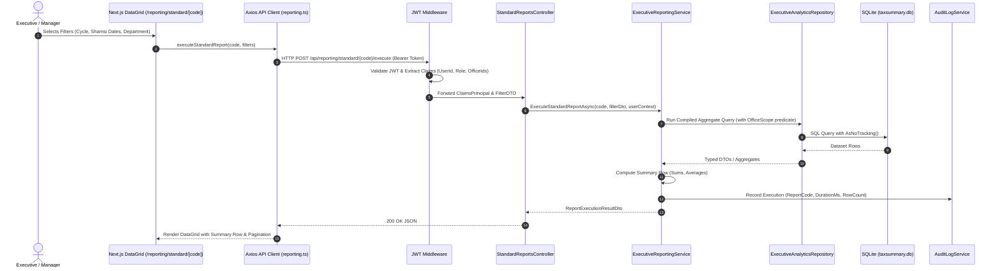
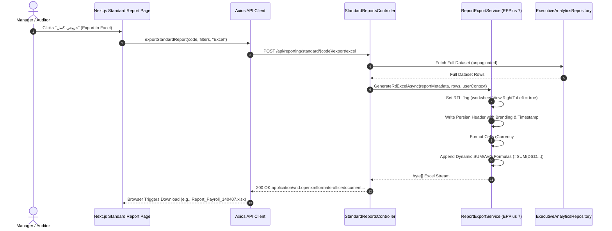

# 00. Architecture and Overview: Executive Reporting & Business Intelligence Module

## 1. System Vision & Purpose

The **Tax Summary Employee App** currently operates three distinct enterprise production modules:
1. **Employee Performance & Evaluation System** (`/reports`): Manages employee dossiers, performance capability metrics (tax issue detection, tax evasion discovery, company identification), attendance statistics (missions, sick/paid leaves, overtime), and printable promotional dossiers.
2. **Collaborative Payroll & Overtime Portal** (`/payroll`): Monthly collaborative overtime and welfare budget distribution, department worksheets, budget cap enforcement (including the 120-hour labor cap), and consolidated multi-sheet Excel generation.
3. **Tax Refund Management System** (`/refunds`): Mechanized processing of tax payback cases under Articles 242 and 243 of the Direct Taxes Act, inquiry tracking, debt deduction, 8-stage approval workflows, and 1.5%/month delay interest compensation calculation.

The **Reporting & Business Intelligence App** (`/reporting`) is designed as the **4th core platform module**. Its primary objective is to break data silos across these three modules, providing executive leadership (Director General, Deputies, Department Heads, Internal Auditors, and HR/Finance Directors) with:
- **Cross-System Unified Analytics**: Correlating employee performance scores with overtime/welfare budget allocations and tax refund audit velocity.
- **Executive KPI Dashboard**: High-level visual metrics, monthly trend curves, budget utilization gauges, and operational bottleneck alerts.
- **Standard Predefined Report Catalog**: 10 production-ready Persian tabular reports with parametric filters (Shamsi dates, offices, categories) and 1-click export.
- **Dynamic Report & Pivot Builder**: An interactive query builder allowing authorized officers to choose fields, apply multi-criteria filters, group by organizational dimensions, and calculate aggregates (SUM, AVG, COUNT, MIN, MAX).
- **Multi-Format Export Engine**: Formatted RTL Excel workbooks (`.xlsx` via EPPlus 7 with formulas and styles), collated A4 Persian printouts, and CSV exports.

---

## 2. Architectural Blueprint & Clean Architecture Integration

Following the project's strict **Clean Architecture** patterns, the Reporting App integrates across all system layers without breaking encapsulation:

```
┌────────────────────────────────────────────────────────────────────────┐
│                        Presentation Layer                              │
│  - Next.js 14 App Router (`frontend/app/reporting/`)                   │
│    * `/reporting`                  ← Executive KPI Dashboard           │
│    * `/reporting/standard`         ← Standard Catalog & Viewer         │
│    * `/reporting/standard/[code]`  ← Parametric Interactive DataGrid   │
│    * `/reporting/builder`          ← Dynamic 5-Step Query & Pivot Tool │
│    * `/reporting/saved`            ← Personal & Office Presets         │
│  - Portal Module Registry (`ExecutiveReportingModule` in portalRegistry)│
│  - Client State: `useAuth`, `MenuSettingsContext`, Axios Client        │
└───────────────────────────────────┬────────────────────────────────────┘
                                    │ HTTP / REST (JWT Bearer Token)
                                    ▼
┌────────────────────────────────────────────────────────────────────────┐
│                             API Layer                                  │
│  - `TaxSummary.Api/Controllers/Reporting/`                             │
│    * `ExecutiveReportingController.cs` (`/api/reporting/executive`)   │
│    * `StandardReportsController.cs`    (`/api/reporting/standard`)    │
│    * `ReportBuilderController.cs`      (`/api/reporting/builder`)     │
│    * `SavedReportsController.cs`       (`/api/reporting/saved`)       │
│  - Middlewares: JwtBearer, OfficeScopeFilter, GlobalExceptionHandling  │
│  - Authorization Policies: `AdminOnly`, `ManagerOrAdmin`, `Auditor`    │
└───────────────────────────────────┬────────────────────────────────────┘
                                    │
                                    ▼
┌────────────────────────────────────────────────────────────────────────┐
│                        Application Layer                               │
│  - Services:                                                           │
│    * `IExecutiveReportingService` & `ExecutiveReportingService`        │
│    * `IReportBuilderEngine` (Expression Tree & Dynamic LINQ)           │
│    * `IReportExportService` (EPPlus RTL Excel & A4 PDF Generator)      │
│    * `ISavedReportsService` (Preset Management)                        │
│  - Caching Layer: `IMemoryCache` (Executive KPI 5-min caching)        │
│  - DTOs, AutoMapper Profiles, FluentValidators with Persian messages   │
└───────────────────────────────────┬────────────────────────────────────┘
                                    │
                                    ▼
┌────────────────────────────────────────────────────────────────────────┐
│                          Domain Layer                                  │
│  - Core Entities:                                                      │
│    * `ReportDefinition`   (Metadata, SQL query/projection config)      │
│    * `SavedReportPreset`  (User customized filters & column choices)   │
│    * `ReportExecutionLog` (Execution audit, timing, rows, exports)     │
│  - Enums: `ReportDomainSource`, `ReportCategory`, `ReportType`,        │
│           `AggregationType`, `ExportFormat`                            │
│  - Repository Interfaces:                                              │
│    * `IReportingRepository`                                            │
│    * `IExecutiveAnalyticsRepository`                                   │
└───────────────────────────────────┬────────────────────────────────────┘
                                    │
                                    ▼
┌────────────────────────────────────────────────────────────────────────┐
│                      Infrastructure Layer                              │
│  - EF Core Configurations & DbContext integration (`taxsummary.db`)    │
│  - Read-Optimized Aggregation Queries (Compiled queries, `AsNoTracking`)│
│  - Repositories: `ExecutiveAnalyticsRepository`, `ReportingRepository` │
│  - Export Generator: `EPPlusReportExportService` (RTL, Formulas, #,#0) │
│  - Database Seeder: `ReportingDataSeeder` (10 Standard Persian Reports)│
└────────────────────────────────────────────────────────────────────────┘
```

---

## 3. Reusable Platform Building Blocks

The reporting module intentionally reuses existing foundational subsystems, avoiding duplication of infrastructure:

| Platform Block | Existing Implementation | Reporting App Reuse Strategy |
|---|---|---|
| **Authentication** | `AuthController.cs`, JWT HS256, Refresh Tokens | Reuses existing bearer tokens; client attaches token automatically via Axios interceptor. |
| **Authorization & Roles** | `Role.cs`, `[Authorize(Roles = "...")]` | Scoped by role: `Admin` (Province-wide full access), `Manager` (Department/Office-scoped access), `Auditor` (Audit logs & compliance). |
| **Office Scoping** | `UserOffice.cs`, `Office.cs` | Automatic filtering of employees, payroll, and refund cases by the current user's assigned offices (`User.FindAll("office_id")`). |
| **Portal Registry** | `frontend/lib/modules/portalRegistry.ts` | Extends `BasePortalModule` as `ExecutiveReportingModule`; renders card on `/`, adds nav link, controls badge and role gate. |
| **Menu Settings** | `MenuSettingsContext.tsx`, `MenuSettingsController.cs` | Allows Admins to dynamically enable/disable the reporting module or specific sub-actions in runtime. |
| **Audit Logging** | `AuditLogsController.cs`, `AuditLog.cs` | Automatic recording of report runs, exports, and query executions in the central audit ledger. |
| **Excel Export Engine** | EPPlus 7 in `TaxSummary.Infrastructure` | Reuses existing styling, font configuration, RTL layout flags, number formatting, and formula generation patterns. |
| **Persian RTL Layout** | Vazirmatn font, Tailwind RTL, Shamsi Date formatting | Reuses date utilities (`persianDate.ts`, `jalaali-js`) and A4 print stylesheet rules. |

---

## 4. End-to-End Execution Sequence Diagrams

### 4.1 Standard Report Execution Flow


### 4.2 EPPlus 7 RTL Excel Export Flow


---

## 5. Security, Authorization & Office Scoping Architecture

### 5.1 Role Hierarchy & Permissions Matrix

| Capability / Route | Admin (مدیر کل و ادمین ارشد) | Manager (رئیس اداره / معاون) | Auditor (حسابرس و بازرس) | Employee (کارمند) |
|---|---|---|---|---|
| **Executive KPI Dashboard** (`/reporting`) | Full Province-wide | Assigned Offices only | Full Compliance view | Restricted / None |
| **Standard Reports Catalog** (`/reporting/standard`) | All 10 Reports | Departmental Reports | Audit & Anomaly Reports | Basic Informational |
| **Excel Export** | Unlimited | Scoped Data only | Scoped Data only | Disabled |
| **Dynamic Report Builder** (`/reporting/builder`) | Full (all domains) | Scoped to own domain | Read-only presets | Disabled |
| **Saved Presets** (`/reporting/saved`) | Manage All + System | Create personal/office | Personal only | Disabled |

### 5.2 Office Scoping Logic (Multi-Tenant Department Isolation)

To enforce strict organizational compliance, queries are automatically filtered based on user claims:
```csharp
// Helper in TaxSummary.Api / Infrastructure
public static IQueryable<T> ApplyOfficeScoping<T>(
    this IQueryable<T> query, 
    ClaimsPrincipal user, 
    Expression<Func<T, Guid?>> officeIdSelector)
{
    var role = user.FindFirst(ClaimTypes.Role)?.Value;
    if (role == "Admin" || role == "Auditor")
    {
        // Admin and Provincial Auditors view entire province
        return query;
    }

    var assignedOfficeIds = user.FindAll("office_id")
        .Select(c => Guid.Parse(c.Value))
        .ToList();

    if (assignedOfficeIds.Count == 0)
    {
        // Empty query if manager has no assigned offices
        return query.Where(_ => false);
    }

    // Predicate: officeIdSelector IN (assignedOfficeIds)
    return query.Where(BuildContainsExpression(officeIdSelector, assignedOfficeIds));
}
```

### 5.3 Dynamic Query Injection Guardrail

The Dynamic Report Builder employs strict whitelisting to eliminate any possibility of SQL injection or dynamic expression vulnerabilities:
- Only fields declared in `DynamicQueryMetadataDto` are accessible.
- Field names are verified against an in-memory dictionary of approved domain properties.
- Only safe aggregation operators (`Sum`, `Avg`, `Count`, `Min`, `Max`) and filter operators (`equals`, `contains`, `greaterThan`, `lessThan`, `between`, `in`) are permitted.
- Raw SQL queries are strictly forbidden; all dynamic queries compile into strongly-typed EF Core Expression Trees.

---

## 6. Cross-System Entity Correlation & Data Dictionary

The reporting engine correlates records across the three operational databases using canonical keys:

```
┌─────────────────────────┐          ┌─────────────────────────┐
│     Employee (HR)       │          │ PayrollEmployeeItem     │
├─────────────────────────┤          ├─────────────────────────┤
│ Id (Guid)               │          │ Id (Guid)               │
│ PersonnelNumber (string)│◄────────►│ PersonnelNumber (string)│
│ ServiceUnit (string)    │          │ Department (string)     │
│ CurrentPosition (string)│          │ OvertimeHours (decimal) │
│ Education (string)      │          │ CalculatedAmount (dec)  │
└───────────┬─────────────┘          └────────────┬────────────┘
            │                                     │
            │ OfficeId / ServiceUnit             │ PayrollCycleId
            ▼                                     ▼
┌─────────────────────────┐          ┌─────────────────────────┐
│    Office (Physical)    │          │      PayrollCycle       │
├─────────────────────────┤          ├─────────────────────────┤
│ Id (Guid)               │          │ Id (Guid)               │
│ Name (string)           │          │ Year (int), Month (int) │
│ Code (string)           │          │ Status (string)         │
└───────────▲─────────────┘          └─────────────────────────┘
            │
            │ TaxOfficeId
            ▼
┌─────────────────────────┐          ┌─────────────────────────┐
│     TaxRefundCase       │          │ RefundableReceiptAlloc. │
├─────────────────────────┤          ├─────────────────────────┤
│ Id (Guid)               │◄────────►│ TaxRefundCaseId (Guid)  │
│ CaseNumber (string)     │          │ TaxSourceId (Guid)      │
│ TaxOfficeId (Guid)      │          │ AllocatedAmount (dec)   │
│ ClaimedRefundAmount     │          │ ExcessPaymentAmount     │
│ DelayCompensationAmount │          └─────────────────────────┘
│ Status (RefundStatus)   │
└─────────────────────────┘
```

### Correlation Rules:
1. **HR to Payroll**: Correlated via `PersonnelNumber`. Enables calculating overtime spending per job tier, education level, or years of experience.
2. **Payroll to Office**: Correlated via `Department` name matched against `Office.Name` or explicit `OfficeId`. Enables tracking department budget variance vs actual headcount.
3. **Refunds to Office**: Correlated via `TaxRefundCase.TaxOfficeId`. Enables comparing refund backlog and 1.5% delay interest compensation across tax offices.
4. **Cross-Departmental Scorecard**: Aggregates (1) total employee count, (2) monthly overtime budget variance, and (3) average tax refund cycle time per office into a single executive ranking matrix.

---

## 7. Performance & High-Capacity Optimization Strategy

| Strategy | Description | Implementation Detail |
|---|---|---|
| **Compiled Queries** | Cache parsed SQL execution plans for frequent KPI counts and sums. | `EF.CompileAsyncQuery(...)` for dashboard hero metrics. |
| **AsNoTracking** | Avoid EF Core entity tracking overhead for read-only reports. | Applied to all reporting queries. |
| **In-Memory Cache (5m)** | Avoid recalculating heavy province-wide aggregates on every request. | `IMemoryCache` stores `ExecutiveDashboardDto` with a 5-minute sliding TTL. Evicted upon cycle approval or refund payment. |
| **Server-Side Pagination** | Never pull large datasets into browser memory. | Enforce `PageSize` (default 50, max 200 for grid). Export endpoints use streaming buffers. |
| **EPPlus Memory Optimization** | Prevent high RAM consumption during large Excel exports. | Uses `ExcelPackage(stream)` directly written to HTTP response stream without creating temporary disk files. |

---

## 8. Complete Project File Manifest

The implementation will introduce or touch the following files across the solution:

```
tax_summary_employee_app/
├── reportingApp_plans/                       ← Detailed Architectural Plans (Reference)
│   ├── 00_ARCHITECTURE_AND_OVERVIEW.md
│   ├── 01_DOMAIN_LAYER_SPECIFICATION.md
│   ├── 02_APPLICATION_LAYER_SPECIFICATION.md
│   ├── 03_INFRASTRUCTURE_LAYER_SPECIFICATION.md
│   ├── 04_API_LAYER_SPECIFICATION.md
│   ├── 05_FRONTEND_UI_UX_SPECIFICATION.md
│   └── 06_STEP_BY_STEP_IMPLEMENTATION_ROADMAP.md
│
├── Backend/
│   ├── TaxSummary.Domain/
│   │   ├── Entities/Reporting/
│   │   │   ├── ReportDefinition.cs          [NEW]
│   │   │   ├── SavedReportPreset.cs         [NEW]
│   │   │   └── ReportExecutionLog.cs        [NEW]
│   │   ├── Enums/ReportingEnums.cs          [NEW]
│   │   └── Interfaces/
│   │       ├── IReportingRepository.cs      [NEW]
│   │       └── IExecutiveAnalyticsRepository.cs [NEW]
│   │
│   ├── TaxSummary.Infrastructure/
│   │   ├── Data/
│   │   │   ├── Configurations/
│   │   │   │   ├── ReportDefinitionConfiguration.cs   [NEW]
│   │   │   │   ├── SavedReportPresetConfiguration.cs  [NEW]
│   │   │   │   └── ReportExecutionLogConfiguration.cs [NEW]
│   │   │   ├── ReportingDataSeeder.cs       [NEW]
│   │   │   └── TaxSummaryDbContext.cs       [MODIFY]
│   │   ├── Repositories/
│   │   │   ├── ReportingRepository.cs       [NEW]
│   │   │   └── ExecutiveAnalyticsRepository.cs [NEW]
│   │   ├── Services/Reporting/
│   │   │   └── ReportExportService.cs       [NEW]
│   │   └── DependencyInjection.cs           [MODIFY]
│   │
│   ├── TaxSummary.Application/
│   │   ├── DTOs/Reporting/
│   │   │   ├── ExecutiveDashboardDto.cs     [NEW]
│   │   │   ├── StandardReportDtos.cs        [NEW]
│   │   │   └── DynamicReportDtos.cs         [NEW]
│   │   ├── Services/Reporting/
│   │   │   ├── IExecutiveReportingService.cs[NEW]
│   │   │   ├── ExecutiveReportingService.cs [NEW]
│   │   │   ├── IReportBuilderEngine.cs      [NEW]
│   │   │   └── ReportBuilderEngine.cs       [NEW]
│   │   ├── Mapping/ReportingMappingProfile.cs [NEW]
│   │   └── Validators/ReportingValidators.cs [NEW]
│   │
│   └── TaxSummary.Api/
│       └── Controllers/Reporting/
│           ├── ExecutiveReportingController.cs [NEW]
│           ├── StandardReportsController.cs    [NEW]
│           ├── ReportBuilderController.cs      [NEW]
│           └── SavedReportsController.cs       [NEW]
│
└── frontend/
    ├── types/reporting.ts                   [NEW]
    ├── lib/
    │   ├── api/reporting.ts                 [NEW]
    │   └── modules/portalRegistry.ts        [MODIFY]
    ├── middleware.ts                        [MODIFY]
    ├── components/reporting/
    │   ├── KpiCard.tsx                      [NEW]
    │   ├── TrendChart.tsx                   [NEW]
    │   ├── DepartmentBarChart.tsx           [NEW]
    │   ├── ReportFilterBar.tsx              [NEW]
    │   ├── DynamicDataTable.tsx             [NEW]
    │   └── ExportActionMenu.tsx             [NEW]
    └── app/reporting/
        ├── layout.tsx                       [NEW]
        ├── page.tsx                         [NEW]
        ├── standard/
        │   ├── page.tsx                     [NEW]
        │   └── [code]/page.tsx              [NEW]
        ├── builder/page.tsx                 [NEW]
        └── saved/page.tsx                   [NEW]
```
